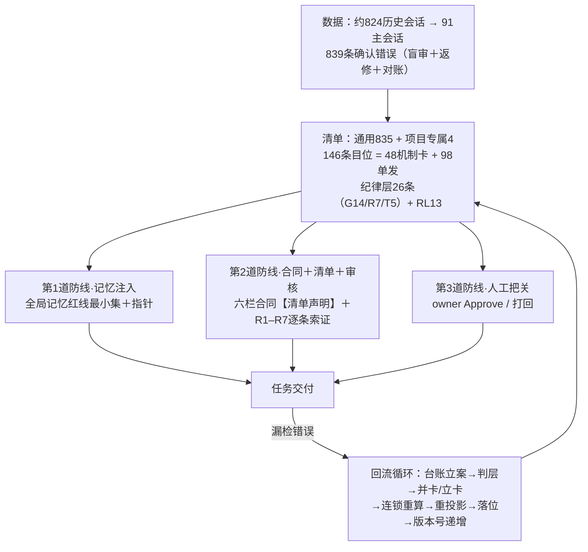

# AI Error Prevention Playbook（AI 防重复犯错手册）

把 839 条真实 AI 犯错复盘成一套可复用、可落地的防错体系：**脱敏数据集 + 三层清单 + 四层防线 + 回流循环**。本仓库所有案例已脱敏：项目与人名以代号（P1…P17、S1…S5）与角色词（owner、审核员）出现，正文不含任何真实姓名、公司名、凭据或内网地址。

## 整体逻辑一图



等价的 ASCII 简版：

```
数据(839) ──> 清单(146条目位/835教训) ──> 三道防线(注入/合同审核/人审) ──> 交付
                  ▲                                                        │
                  └────────────── 回流循环（漏检错误→新条目→版本递增）◄────┘
```

## English TL;DR

This repository turns 839 confirmed AI mistakes — mined from ~824 historical work sessions through blind review, repair, and full reconciliation — into a reusable error-prevention system. It contains: (1) a sanitized dataset of 146 checklist entries carrying 835 generalizable lessons across ten error classes; (2) a three-tier checklist discipline (operator / reviewer / captain rules, 13 exit self-checks, and 48 failure-mechanism cards); (3) a six-field task contract whose mandatory checklist declaration injects the right rules into every task; and (4) a four-layer defense — injection, process, enforcement, audit — closed by a feedback loop that converts every missed error into a new, versioned checklist entry, so defenses thicken with use. All cases are de-identified: projects and people appear only as codes and role words. Adopt it in any agent tool: retrieve the checklist before team formation, inject it into prompts, and enforce gates in hooks/CI.

## 仓库结构

```
ai-error-prevention-playbook/
├── README.md                                ← 本文件
├── INDEX.md                                 ← 目录索引（指针文件：每件内容一行导航）
├── LICENSE                                  ← MIT（仓库代码默认许可）
├── docs/
│   └── methodology.md                       ← 方法论：复盘流水线/四层防线/回流循环/指针文件机制
├── playbook/                                ← 模板库（复制即用）
│   ├── team-contract-template.md            ← 六栏任务合同模板（含脱敏填写示例）
│   ├── reviewer-quick-reference.md          ← 审核员速查清单脱敏版（G/R/T/RL 全条 + 48 张机制卡）
│   ├── lesson-card-template.md              ← 教训卡模板（错误台账 + 三选一规则化）
│   └── project-root-checklist-template.md   ← 项目根 1 层清单模板
├── integration/
│   └── how-to-adopt.md                      ← 接入指南：建队前检索清单 → 注入提示词
└── dataset/                                 ← 脱敏犯错清单数据集（146 条目位 / 835 教训）
```

## Quick Start（三步接入）

1. **读方法论**：`docs/methodology.md` —— 20 分钟理解数据从哪来（复盘流水线）、体系怎么设计（四层防线：L1 注入 / L2 流程 / L3 强制 / L4 审计）、错误如何不再犯第二遍（回流循环 + 指针文件机制）。
2. **拷模板**：把 `playbook/` 四件模板拷进你的团队规范——六栏任务合同（必带【清单声明】栏）、审核员速查清单（按角色跳卡，不通读）、教训卡（台账 + 三选一规则化）、项目根清单（只收项目专属教训）。
3. **接工具**：按 `integration/how-to-adopt.md` 落地"建队前检索清单 → 注入提示词"全链路——DSH AgentTeams 原生接法（全局记忆 + 建队纪律 + 质量门）或任意 agent 工具通用接法（CLAUDE.md/系统提示注入 + hooks 门禁选配）。

## 数据集说明（dataset/）

- **规模**：146 个条目位（48 条目卡 + 98 单发），承载 **835 条通用教训**（另有 4 条项目专属，全库合计 **839 条确认错误**；逻辑条数 822 = 835 − 13 双版本折叠）。
- **口径**：severity 分布 blocker 9 / high 131 / medium 314 / low 385；发现渠道：用户当时纠出 414（49.3%）｜当时没人发现 348｜AI 自查自纠 56｜另一审核 AI 发现 21。
- **分类**：十大类 A 假完成/没验证、B 文件/数据搞坏、C 交付物生成缺陷、D 数字/口径错、E 猜测当结论、F 引用/来源有假、G 工具用法错、H 理解偏差/指令遵循、I 流程失控/无效循环、Z 长尾杂项。
- **键**：每条教训唯一键 = `批次码:会话短id:E##`（会话短 id 为来源复盘体系的匿名会话短标识，无身份信息，读者不可反查原文），支持"错误 → 规则 → 回流 → 复发计数"闭环对账。
- **来源**：约 824 个历史 AI 工作会话（登记口径），经 8 批次盲审标注 → 独立复审返修 → 全链数字对账确认；每个数字旁标注口径短语，防止 822/835/839 混用。

## 脱敏声明

**本项目所有案例已脱敏：项目/人名以代号与角色词出现。**

- 真实项目名/客户名 → 项目代号 P1…P17；供应商/第三方 → S1…S5；批次名 → B2…B63；
- 人名 → 角色词（owner／审核员／同事A／同事B）；"蒙眼审核"表述统一为"盲审"；
- 内部路径 → `<project-root>` 等占位符；一切凭据/账号/内网地址零出现；城市名不入正文；
- 案例正文只做机制级改写（失败机制与正确做法零改动），并对交付正文执行红线词表机器扫描（命中必须为 0）。

## 许可

- 仓库代码与模板默认按 **MIT** 许可（见 `LICENSE`）；
- **文档（docs/、playbook/、integration/）与数据集（dataset/）按 CC BY 4.0** 许可；
- 署名只使用 GitHub 账号名（版权人行），不使用任何真实姓名或公司名。
