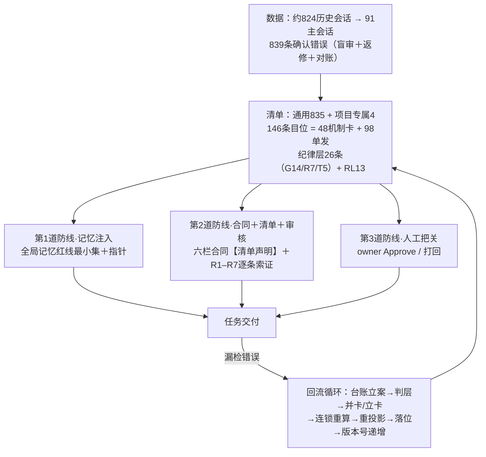

# AI Error Prevention Playbook（AI 防重复犯错手册）

把 839 条真实 AI 犯错复盘成一套可复用、可落地的防错体系：**脱敏数据集 + 三层清单 + 四层防线 + 回流循环**。本仓库所有案例已脱敏：项目与人名以代号（P1…P17、S1…S5）与角色词（owner、审核员）出现，正文不含任何真实姓名、公司名、凭据或内网地址。

## 整体逻辑一图



等价的 ASCII 简版：

```
数据(839) ──> 清单(146条目位/835教训) ──> 三道防线(注入/合同审核/人审) ──> 交付
                  ▲                                                        │
                  └────────────── 回流循环（漏检错误→新条目→版本递增）◄────┘
```

## English TL;DR

This repository turns 839 confirmed AI mistakes — mined from ~824 historical work sessions through blind review, repair, and full reconciliation — into a reusable error-prevention system. It contains: (1) a sanitized dataset of 146 checklist entries carrying 835 generalizable lessons across ten error classes; (2) a three-tier checklist discipline (operator / reviewer / captain rules, 13 exit self-checks, and 48 failure-mechanism cards); (3) a six-field task contract whose mandatory checklist declaration injects the right rules into every task; and (4) a four-layer defense — injection, process, enforcement, audit — closed by a feedback loop that converts every missed error into a new, versioned checklist entry, so defenses thicken with use. All cases are de-identified: projects and people appear only as codes and role words. Adopt it in any agent tool: retrieve the checklist before team formation, inject it into prompts, and enforce gates in hooks/CI.

## 仓库结构

```
ai-error-prevention-playbook/
├── README.md                                ← 本文件
├── INDEX.md                                 ← 目录索引（指针文件：每件内容一行导航）
├── LICENSE                                  ← MIT（仓库代码默认许可）
├── docs/
│   └── methodology.md                       ← 方法论：复盘流水线/四层防线/回流循环/指针文件机制
├── playbook/                                ← 模板库（复制即用）
│   ├── team-contract-template.md            ← 六栏任务合同模板（含脱敏填写示例）
│   ├── reviewer-quick-reference.md          ← 审核员速查清单脱敏版（G/R/T/RL 全条 + 48 张机制卡）
│   ├── lesson-card-template.md              ← 教训卡模板（错误台账 + 三选一规则化）
│   └── project-root-checklist-template.md   ← 项目根 1 层清单模板
├── integration/
│   └── how-to-adopt.md                      ← 接入指南：建队前检索清单 → 注入提示词
└── dataset/                                 ← 脱敏犯错清单数据集（146 条目位 / 835 教训）
```

## Quick Start（三步接入）

1. **读方法论**：`docs/methodology.md` —— 20 分钟理解数据从哪来（复盘流水线）、体系怎么设计（四层防线：L1 注入 / L2 流程 / L3 强制 / L4 审计）、错误如何不再犯第二遍（回流循环 + 指针文件机制）。
2. **拷模板**：把 `playbook/` 四件模板拷进你的团队规范——六栏任务合同（必带【清单声明】栏）、审核员速查清单（按角色跳卡，不通读）、教训卡（台账 + 三选一规则化）、项目根清单（只收项目专属教训）。
3. **接工具**：按 `integration/how-to-adopt.md` 落地"建队前检索清单 → 注入提示词"全链路——DSH AgentTeams 原生接法（全局记忆 + 建队纪律 + 质量门）或任意 agent 工具通用接法（CLAUDE.md/系统提示注入 + hooks 门禁选配）。

## 每次新开任务时会发生什么？（跟一个例子走一遍）

四层防线听起来抽象，落到一次真实任务里，其实是一条固定的时间线。我们跟一位虚构用户**小A**走一遍：她对 AI 助手说——「帮我把三个区域上个季度的销售数据整理成一份 Excel 汇总，周五给经理。」

整个流程一共 6 步；其中小A 需要亲自动手的是 0 件——除了最后验收时说一声「可以」。防错不是靠人盯，是靠让教训在正确的时刻出现在 AI 面前。

### T0 · 任务进来的瞬间（环①：全局记忆铁律，自动发生）

小A 什么都没做，但 AI 已经带着**全局记忆铁律**开工了：几条「每条一行的最高优先级红线」（比如：AI 推测必须标注「未经证实」；断言「不存在」之前必须穷举清单二次复核），再加一行指针（清单正本在哪、按需怎么查）。新会话开局自动注入，不占小A 一点心智。

> 为什么常驻注入只有这几条？因为指令密度越高、遵守率反而越低——所以每个会话只放「指针行 + ≤6 条红线」，其余纪律按任务临时注入（`integration/how-to-adopt.md` §3.2）。

### T1 · 开工第一件事：读项目根清单（环③）

AI 动手前先翻**项目根 1 层清单**——放在项目文件夹里的那份「本项目踩坑记录」（模板：`playbook/project-root-checklist-template.md`）。它只收这个项目专属的教训，比如：

> 「区域C 原始表存在重复列名，合并前必须先改名。」

本次任务命中这条，AI 把它记进工作备忘。项目还没有这份清单？用模板建一个，空的也行——它会随项目一起成长。

### T2 · 干活前，把「必查项」写进合同（环②+④）

如果是团队任务，队长在建队、派活前必须先读两份正本（纪律 **T1**），再照模板写合同（纪律 **T2**）：

- **审核员速查清单**（`playbook/reviewer-quick-reference.md`）：纪律条 + 48 张机制卡（每张卡 = 一类反复出现的失败机制）；
- **团队合同模板**（`playbook/team-contract-template.md`）：六栏——【工作区｜任务内容｜清单声明｜验货｜破坏性动作｜项目专属清单】。

然后是整个体系最有灵魂的一步：**按任务类型检索清单、选出必查项**，写进合同的【清单声明】栏。本例是「做表格、算数字」，路由表给出：G1（数字必须能对上）、G5（后台任务双信号才算跑完）、G6（计数结论本级重算）、G11（宣称「全了」前换第二种口径交叉验证）、G12（改筛选/修复规则两头核对）。检索可以人工扫路由表，也可以用检索器（`integration/how-to-adopt.md` §2）——**检索是建议，选卡决策始终是人**。

【清单声明】= 适用清单版本 + 选中条目编号，缺这一栏整个方案作废。哪怕是小A 这种单人小任务，合同压缩成三行也要写——这就是把教训注入本次任务提示词的动作。压到最简长这样：

```
【工作区】本项目文件夹（销售表所在目录）
【任务内容】合并三区域季度销售表 → 一份汇总 Excel，周五交付
【清单声明】速查清单 v1；选中 G1 / G6 / G11（数字对上·计数重算·换口径验证）
【验货】交付前真实打开 Excel，行数与合计各数一遍
【破坏性动作】无（不删除、不覆盖任何原始表）
```

### T3 · 干活中：出口自查（环⑤前半）

AI 每次准备宣称「搞定」之前，对照 **RL 出口自查**（速查清单里 13 条逐条过的自查项，按动作路由：「做表格、算数字」对应出口前自查）。合并完三张表，自查提醒先真打开看一遍——打开发现区域C 有 12 行单位错位。**自查把错误挡在了宣称之前。**

### T4 · 审核：换一双眼睛（环⑤后半）

交付前，**审核员**（独立于干活者的第二双眼睛，审核者≠生产者）按合同的【清单声明】逐条索要证据。为什么非要换人查？因为自己查自己有结构性盲区——同一个人（或同一个 AI 会话）很难看见自己的惯性错误，这是本体系十条设计公理之一（`docs/methodology.md` §2.3）：

- **R1**：选中条目一条一条要证据，缺一条整体打回；
- **R7**：审核员通读清单后，可自行增补合同没覆盖但适用的条目（防止队长选漏）；
- **R5**：结论只有「通过 / 打回」两格，打回必须逐条分级写明问题。

本例：审核员向 G1 索证时发现汇总页一处小计与明细之和对不上——打回，AI 修复后重审通过。

### T5 · 交付之后：这次学到的进清单（环⑥）

小A 验收通过，Excel 交付。故事没完——审核抓到的「单位错位」如果清单里还没有，就按**回流七步**蒸馏成一条新条目（用教训卡模板 `playbook/lesson-card-template.md`；纪律 **T5**：先回写来源台账——一份每条错误一行的错误登记册，可追溯——再进清单），清单版本号递增。

下次**任何项目**再遇到同类问题，T2 的检索就会把这条新教训送进新的合同。防线越用越厚——这正是「防重复犯错」区别于「防错」的地方。

### 六环 × 时间线 × 文件对照

| 时间点 | 环 | 谁在做 | 用到的文件 |
|---|---|---|---|
| 任务进来 | ① 全局记忆铁律 | 自动 | 常驻注入（`integration/how-to-adopt.md` §3.2） |
| 开工 | ③ 项目根 1 层清单 | 执行者 | `playbook/project-root-checklist-template.md` |
| 干活前 | ② 建队前必读正本 + ④ 任务合同【清单声明】栏 | 队长 / owner | `playbook/reviewer-quick-reference.md`、`playbook/team-contract-template.md`、`integration/how-to-adopt.md` §2 |
| 干活中 | ⑤ RL 出口自查 | 执行者 | 速查清单 RL 节 |
| 交付前 | ⑤ 审核员按清单审 | 审核员 | 合同【清单声明】+ 速查清单 R 节 |
| 交付后 | ⑥ 漏检回流 + 版本递增 | 全员 | `playbook/lesson-card-template.md` |

完整版见 docs/methodology.md §4 指针文件机制全链路。

## 数据集说明（dataset/）

- **规模**：146 个条目位（48 条目卡 + 98 单发），承载 **835 条通用教训**（另有 4 条项目专属，全库合计 **839 条确认错误**；逻辑条数 822 = 835 − 13 双版本折叠）。
- **口径**：severity 分布 blocker 9 / high 131 / medium 314 / low 385；发现渠道：用户当时纠出 414（49.3%）｜当时没人发现 348｜AI 自查自纠 56｜另一审核 AI 发现 21。
- **分类**：十大类 A 假完成/没验证、B 文件/数据搞坏、C 交付物生成缺陷、D 数字/口径错、E 猜测当结论、F 引用/来源有假、G 工具用法错、H 理解偏差/指令遵循、I 流程失控/无效循环、Z 长尾杂项。
- **键**：每条教训唯一键 = `批次码:会话短id:E##`（会话短 id 为来源复盘体系的匿名会话短标识，无身份信息，读者不可反查原文），支持"错误 → 规则 → 回流 → 复发计数"闭环对账。
- **来源**：约 824 个历史 AI 工作会话（登记口径），经 8 批次盲审标注 → 独立复审返修 → 全链数字对账确认；每个数字旁标注口径短语，防止 822/835/839 混用。

## 脱敏声明

**本项目所有案例已脱敏：项目/人名以代号与角色词出现。**

- 真实项目名/客户名 → 项目代号 P1…P17；供应商/第三方 → S1…S5；批次名 → B2…B63；
- 人名 → 角色词（owner／审核员／同事A／同事B）；"蒙眼审核"表述统一为"盲审"；
- 内部路径 → `<project-root>` 等占位符；一切凭据/账号/内网地址零出现；城市名不入正文；
- 案例正文只做机制级改写（失败机制与正确做法零改动），并对交付正文执行红线词表机器扫描（命中必须为 0）。

## 许可

- 仓库代码与模板默认按 **MIT** 许可（见 `LICENSE`）；
- **文档（docs/、playbook/、integration/）与数据集（dataset/）按 CC BY 4.0** 许可；
- 署名只使用 GitHub 账号名（版权人行），不使用任何真实姓名或公司名。
